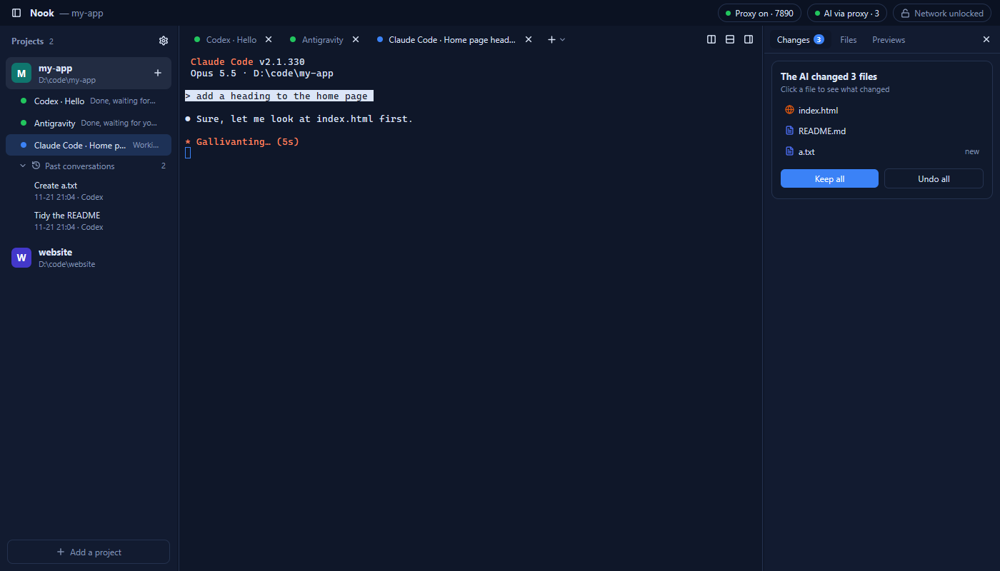
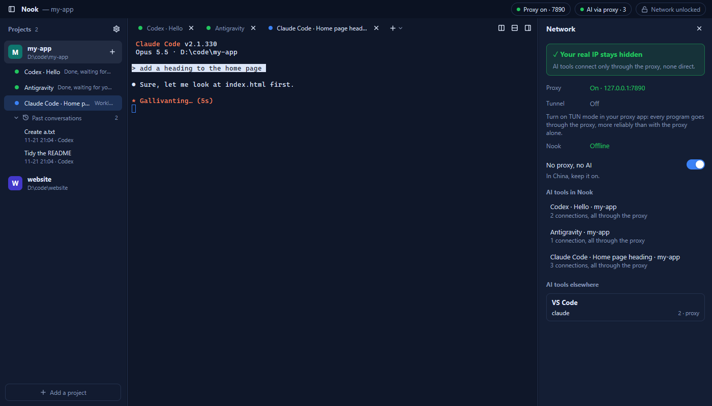
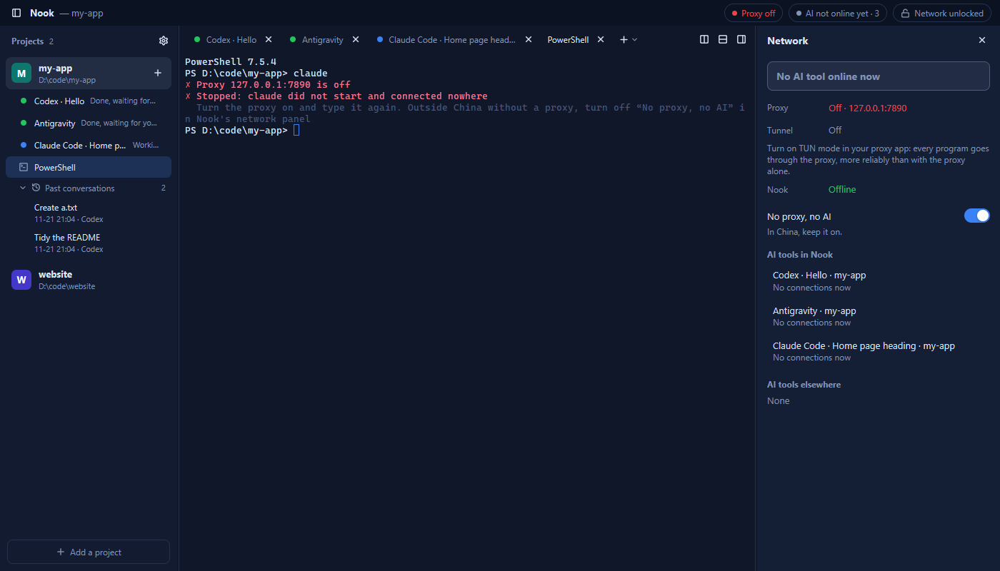
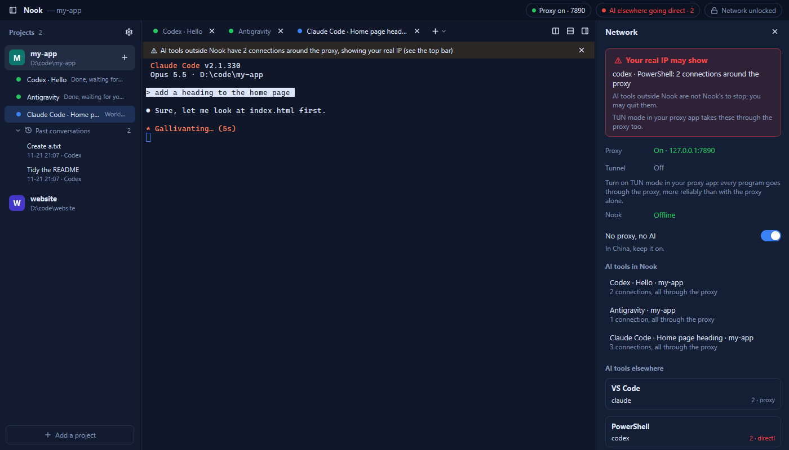
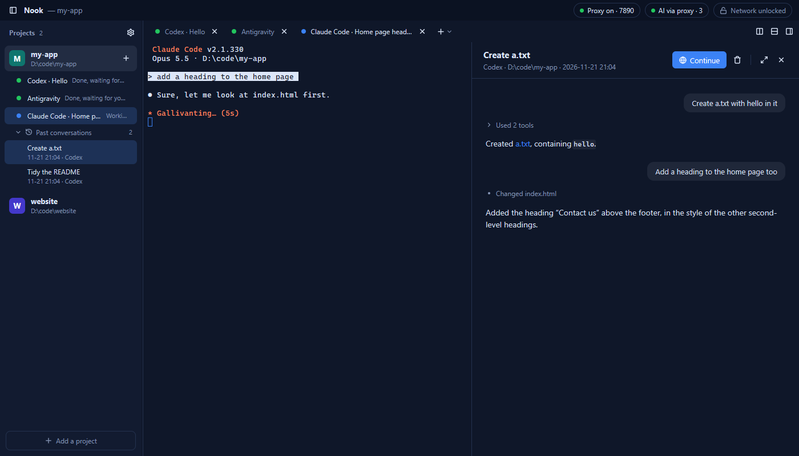
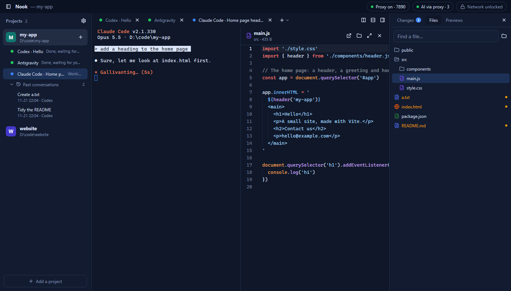
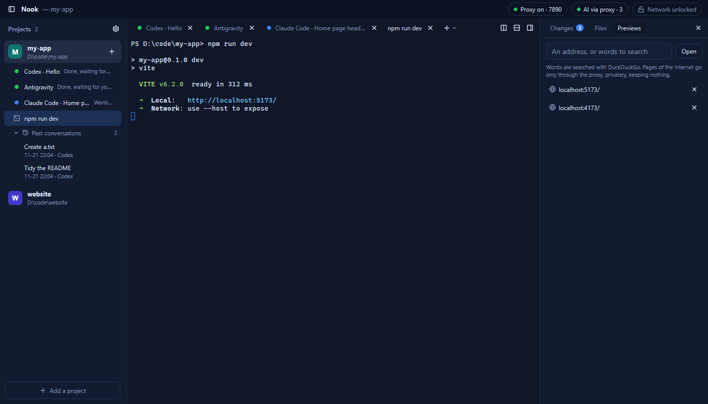

<div align="center">

# Nook

**A terminal for AI command-line tools that keeps their networking in your hands**

Claude Code, Codex and Antigravity run inside as they are; around them, projects, past conversations, changes and previews

Windows only · Free and open source · Nook itself never goes online

[Download](../../releases) · [Guide](docs/使用说明.md#english) · [中文](README.md)



</div>

## A look

### Whether your real IP shows, at a glance

The network panel says it first, in one line. Below, every AI tool's connections, through the proxy or direct, including those started outside Nook (in VS Code, in another terminal).



### No proxy, no AI

Type `claude` or `codex` in Nook's terminals and Nook checks the proxy and the tunnel (TUN) first: when they work, the tool starts with the proxy; when they don't, it is stopped before sending a single byte. A network lock stops every AI tool from starting.



### Direct connections do not slip by

An AI tool connecting around the proxy turns the top bar and the panel red, with a notification when the window is in the background. Commands and processes the AI starts count as its own. Codex started without the proxy in a PowerShell window outside Nook shows too.



### Keep or undo what the AI changed

The files an AI changed are listed on a card (see the first picture): click one to see what changed, then keep or undo them all, or one by one. The originals wait on the project's own drive and go once you decide.

The copy keeps what writing code changes: pictures, videos, archives, models and datasets (binary files over 1 MB) are left out, so tens of gigabytes of data in a project neither slow it down nor fill the drive. What the AI does to them is still listed, in grey: seen, not undone. When what is to be kept comes to over 1 GB, changes are not tracked, and Nook suggests adding the folders not needed to `.gitignore`.

### Past conversations, to read and to continue

The sidebar keeps the conversations of Nook's terminals. Open one to read it, Markdown laid out and tool calls folded; “Continue” picks it up in its folder. Several of the same AI tool stay apart: tabs say “AI · conversation title”.



### Files, without leaving the window

The Files tab is the project's tree, with a dot on the files the AI just changed. Code, Markdown, pictures and videos open beside the terminals with a click, code highlighted; search by name, or right-click to type a path into the terminal. Programs and scripts double-clicked are shown, not run.



### Previews that leave no trace

Start a development server (as `npm run dev`) and the `localhost` addresses its terminal prints are listed under Previews: a click opens one beside the terminals, with back, forward, reload, and a button to widen it. The address bar takes addresses, or words to search with DuckDuckGo. Pages of the internet go only through the proxy, as in a private window: cookies and history stay in memory and go as Nook quits.



## Features

- **The tools as they are**: the terminals run the Claude Code, Codex… you installed. Nook changes nothing in `~/.claude` or `~/.codex`, nor a project's `.git`.
- **What desktop apps give, in a terminal**: projects, past conversations, keeping or undoing changes, a file tree, a viewer for code, Markdown, pictures and videos, previews of `localhost` pages, in one window.
- **Light**: a native program, not a web page in a frame; an installer of about 8 MB that opens at once. Quit Nook and no process it started is left.
- **Handy**: tabs, splits, drag to reorder, find in a terminal (`Ctrl+Shift+F`), files dragged into a terminal, screenshots pasted to the AI, the tray, a command palette (`Ctrl+Shift+P`).
- **Your look**: a few ready color schemes, over a hundred Ghostty terminal themes, and a board to recolor any part by clicking it.
- **More than three tools**: Claude Code, Codex and Antigravity have their past conversations read; Gemini CLI, Qwen Code, Kimi CLI, OpenCode, Copilot CLI and more run inside too, their networking seen and guarded the same, and others can be added in the settings.
- Chinese and English; PowerShell 7, Windows PowerShell, cmd and Git Bash. WSL opens too, but the AI tools in it are out of Nook's reach (see the questions below).

## Privacy

- **Nook itself never goes online**: no statistics, no telemetry, no updates, no account. The “Nook” line of the network panel always says “Offline”.
- Only buttons marked with a globe (continue a conversation, open a page of the internet, search) make an AI tool or a page connect, and none do while the network lock is on.
- Pages of the internet open through the proxy only, as in a private window: cookies and history stay in memory and go as Nook quits.
- The AI tools' conversations are read where they keep them, never changed, never sent anywhere.
- Programs and scripts (exe, bat, ps1, js…) double-clicked in the file panel are shown, not run.
- The settings are one plain file, `%APPDATA%\Nook\state.json`, to open and read; all the code is public (GPL-3.0).

## Install

Download `nook-setup-<version>-amd64.exe` from [Releases](../../releases) and run it; no administrator rights needed. It installs in `%LOCALAPPDATA%\Programs\Nook` unless you choose another folder, with Nook in the Start menu.

- The installer is not signed: if Windows says it protected your PC, click “More info”, then “Run anyway”.
- **Update**: run the newer installer; it installs where Nook is. Settings and past conversations stay.
- **Uninstall**: from Settings > Apps. It asks whether to delete Nook's settings, its list of past conversations and the backups of changes too (no by default). The AI tools' own conversation files and your projects are never touched.
- Windows 10 1809 or later, x64. Undoing changes needs [Git](https://git-scm.com); pages show in the system's WebView2 (Windows 11 has it). Install the AI tools (Claude Code, Codex…) yourself.
- **Mac, Linux**: not supported.

## Questions

**Do I need a proxy?** No. Without one, turn off “No proxy, no AI” in the network panel; everything else works, and connections are still listed.

**Does Nook change my AI tools' settings?** No. What stops them is a small guard named `claude.exe`, `codex.exe`… in Nook's own folder, first in PATH in Nook's terminals only; `claude` typed in another terminal runs as before.

**Nook first, the proxy later?** Fine: each time you type `claude` or `codex`, the guard looks for the proxy again and passes it on once found.

**And AI tools outside Nook?** Seen, not stopped: their connections are listed under “AI tools elsewhere”, turning red with a notification when direct, but Nook never ends other programs. TUN mode in your proxy app takes them all through the proxy.

**AI tools in WSL?** Out of reach: WSL's programs run in a Linux virtual machine, where the guard cannot stop them and their connections cannot be told apart. To use AI tools in WSL, turn on TUN mode in your proxy app, which usually takes WSL's traffic too.

**How does Nook tell where connections go?** Every two seconds it reads Windows' table of TCP connections and looks where the AI tools and their child processes connect: to the local proxy's port is through the proxy, out to the internet is direct. It only reads this computer: no packet capture, nothing online.

## Partner: Red Crab

[Red Crab](https://github.com/BigBrother168/red-crab) is a desktop pet that works along with the AI, made by us too. It knows Nook: click a conversation's circle to go straight to that terminal in Nook.

## Build

With Go 1.27 or later, in Git Bash:

```sh
go test ./...
scripts/build.sh   # build/windows-amd64/, with the installer
```

The window is [MyGo](https://github.com/egoist/mygo) (native Go UI), the terminal core [Ghostty](https://ghostty.org)'s libghostty-vt, under Microsoft's [ConPTY](https://github.com/microsoft/terminal). The code's map is in the [Chinese README](README.md#从源码构建).

## License

- The code is © 2026 BigBrother, released under [GPL-3.0](LICENSE): use it, change it and share it freely; changed versions are to be open source under the same license.
- The third-party software that comes with it (MyGo, libghostty-vt, terminal themes, Go: MIT, BSD, Apache) has its licenses in `resources/THIRD-PARTY-NOTICES.txt`, and Microsoft's ConPTY in `resources/conpty-NOTICE.txt`; both are in the program's folder once installed.
- Claude Code, Codex, Antigravity, VS Code, Windows and the other names belong to their companies; they are named only to say what Nook works with.
