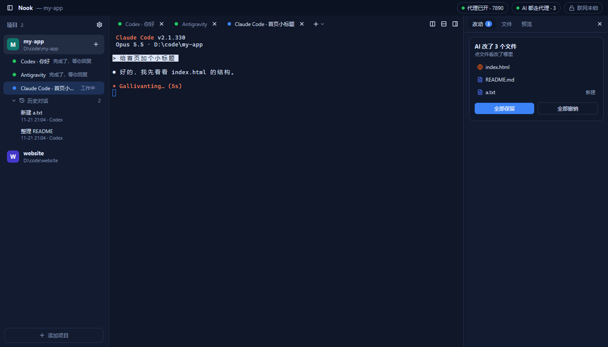
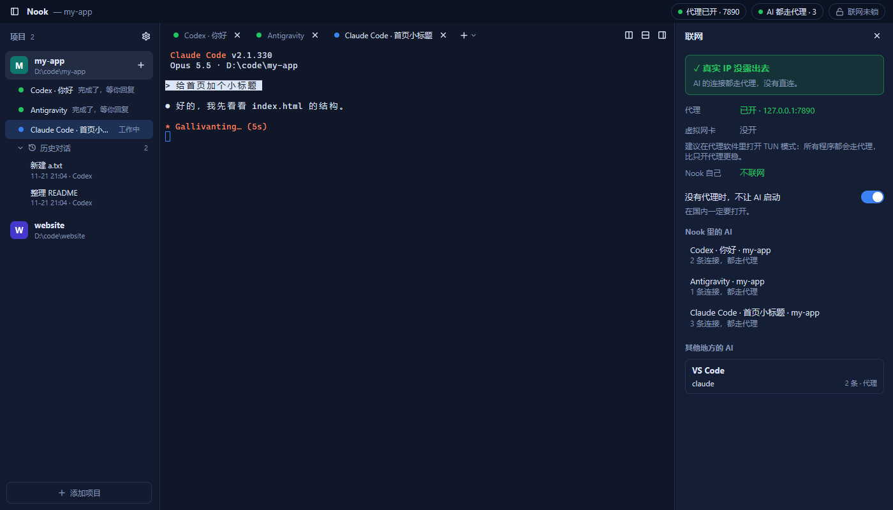
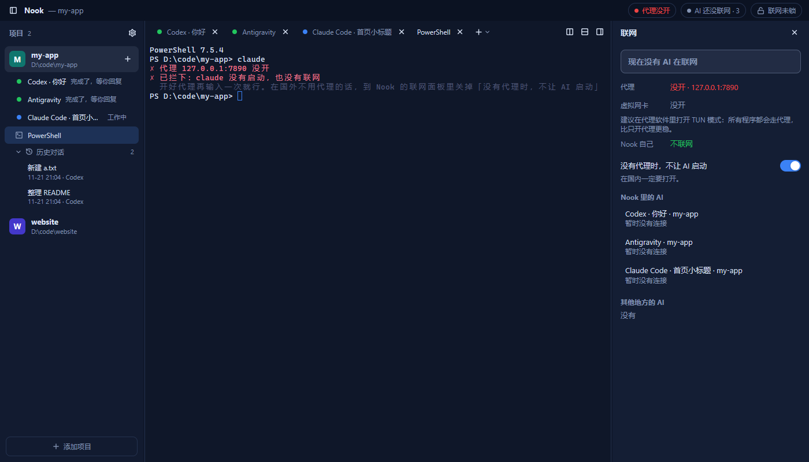
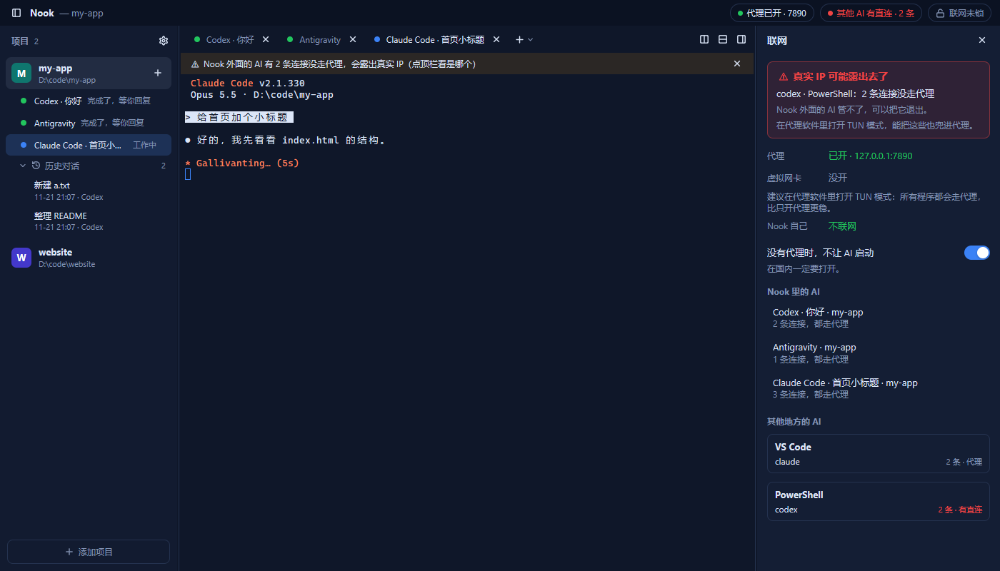
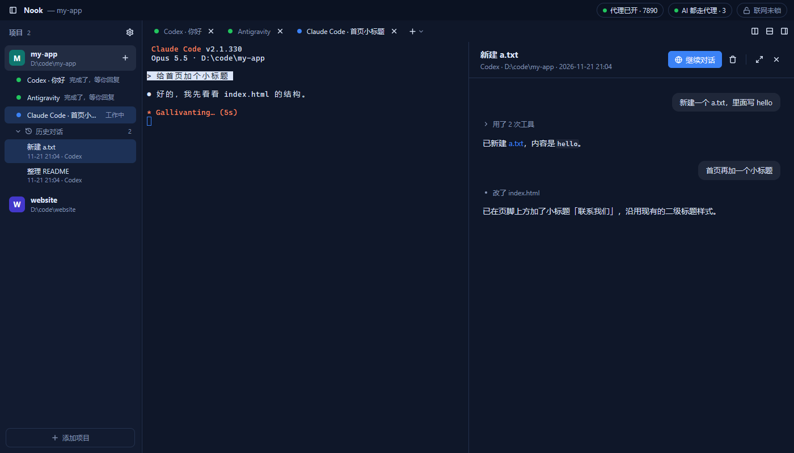
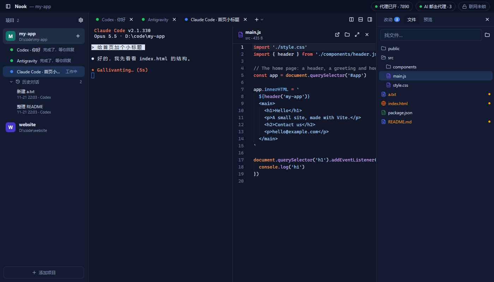
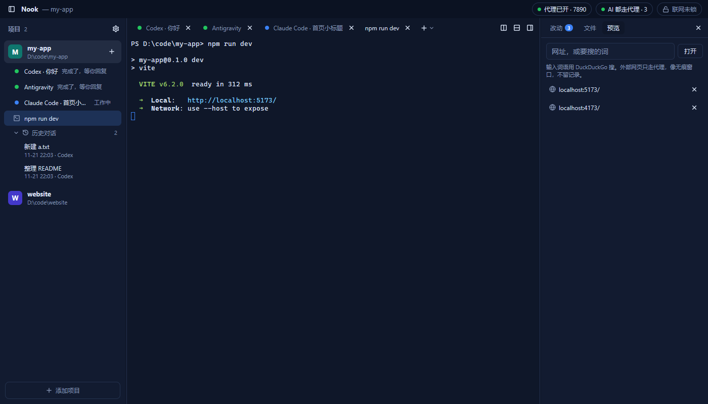

<div align="center">

# Nook

**替你管住联网的 AI 命令行终端**

Claude Code、Codex、Antigravity 原样跑在里面，外面是项目、历史对话、改动和预览

仅支持 Windows · 免费开源 · Nook 自己不联网

[下载安装包](../../releases) · [使用说明](docs/使用说明.md) · [English](README.en.md)



</div>

## 看一看

### 真实 IP 有没有露出去，一眼就知道

联网面板最上面一句话就是结论。下面列出每个 AI 开了几条连接、走代理还是直连；Nook 外面开的 AI（VS Code 里的、别的终端里的）也算在内。



### 没开代理，AI 根本起不来

在 Nook 的终端里输入 `claude`、`codex`，Nook 先查代理和虚拟网卡（TUN）：通了才放行，并把代理交给 AI；不通就拦下，AI 一个字节都不发。还有一把联网锁，锁上后任何 AI 都不能启动。



### 漏网的直连也抓得到

哪个 AI 绕开代理连了出去，顶栏和面板马上变红，窗口不在前台也会发通知。AI 帮你跑的命令、开的子进程都算在它头上。比如在 Nook 外面另开一个 PowerShell 跑 `codex` 又没带代理，Nook 也看得见。



### 改了什么，留不留你说了算

AI 改过的文件列成一张卡片（见最上面的图），点开看改了哪里，全部或逐个保留、撤销。备份放在项目所在的盘，处理完就删。

备份只存写代码会改的东西：图片、视频、压缩包、模型、数据集这类大文件（1 MB 以上的二进制文件）自动跳过，项目里放着几十 GB 数据也不会卡、不会占硬盘。AI 要是动了它们，卡片里照样用灰色列出来，看得见，只是撤销不了。要备份的东西超过 1 GB 时干脆不记录，提醒你把不用的文件夹写进 `.gitignore`。

### 历史对话随时翻，一键接着聊

左栏记住在 Nook 里开过的对话。点开看记录，Markdown 排好版、工具调用折叠起来；点「继续对话」就在原来的文件夹接着聊。同一个 AI 开几个也分得清：标签写「AI · 对话标题」。



### 看文件不用切窗口

右边「文件」是项目的文件树，AI 刚改过的文件带个点。代码、Markdown、图片、视频点一下就在终端旁边打开，代码有高亮；可以搜文件名，右键把路径打进终端。程序和脚本双击也只显示内容，不会误运行。



### 网页预览，不留痕迹

跑起开发服务器（比如 `npm run dev`），终端里出现的 `localhost` 地址会自动列在「预览」里，点一下就在终端旁边打开，能前进、后退、刷新，也能放大占满。地址栏还能输入网址，或者输入词语用 DuckDuckGo 搜。外部网页只走代理，像无痕窗口：Cookie 和浏览记录只在内存里，退出 Nook 就没了。



## 特点

- **跑的是原版 AI**：终端里就是你装的 Claude Code、Codex……Nook 不改 `~/.claude`、`~/.codex` 里的任何设置，也不碰项目自己的 `.git`。
- **桌面版的方便，终端的自由**：项目、历史对话、改动保留 / 撤销、文件树、代码 / Markdown / 图片 / 视频查看、`localhost` 预览，都在一个窗口里。
- **轻**：原生程序，不是网页套壳，安装包 8 MB 左右，秒开；退出 Nook，它开的进程一个不留。
- **顺手**：多标签、分屏、拖动排顺序、在终端里找（`Ctrl+Shift+F`）、拖文件进终端、截图直接粘给 AI、托盘、命令面板（`Ctrl+Shift+P`）。
- **外观随你配**：几套现成配色、上百套 Ghostty 终端主题，还有一块画板，点哪改哪。
- **不止三家**：Claude Code、Codex、Antigravity 能读历史对话；Gemini CLI、Qwen Code、Kimi CLI、OpenCode、Copilot CLI 等也能在里面跑，联网一样看得见、管得住，还能在设置里加上别的。
- 中文 / English；PowerShell 7、Windows PowerShell、cmd、Git Bash 都能用。WSL 也能开，但里面的 AI 管不到（见常见问题）。

## 隐私

- **Nook 自己不联网**：没有统计、没有遥测、没有自动更新、没有账号。联网面板里「Nook 自己」那一行一直是「不联网」。
- 只有你点了带小地球的按钮（继续对话、打开外部网页、搜索），才会有 AI 或网页联网；联网锁锁上时这些都不会发生。
- 预览外部网页只走代理，像无痕窗口：Cookie、浏览记录只在内存里，退出 Nook 就没了。
- 只读 AI 存在本机的对话记录，从不修改，也不上传。
- 文件面板里双击程序或脚本（exe、bat、ps1、js……）只显示内容，不会直接运行。
- 设置是一个明文文件 `%APPDATA%\Nook\state.json`，可以直接打开看；代码全部公开（GPL-3.0）。

## 安装

在 [Releases](../../releases) 下载 `nook-setup-<版本>-amd64.exe` 运行就行，不要管理员权限。默认装在 `%LOCALAPPDATA%\Programs\Nook`，可以自己选位置；装完开始菜单里有 Nook。

- 安装包没有数字签名，Windows 可能弹出“Windows 已保护你的电脑”：点“更多信息”→“仍要运行”。
- **升级**：直接运行新版的安装包，会装回原来的位置。设置和历史对话不受影响。
- **卸载**：在 Windows 设置 → 应用里卸载，会问要不要把设置、历史对话列表和改动备份一起删（默认不删）。AI 自己存的对话记录和你的项目都不会动。
- 需要 Windows 10 1809 或更新的版本（x64）。撤销改动需要装 [Git](https://git-scm.com)；预览网页用系统自带的 WebView2（Windows 11 已经有）。AI 命令行（Claude Code、Codex……）要你自己装好。
- **Mac、Linux**：暂不支持。

怎么用见 [使用说明](docs/使用说明.md)。

## 常见问题

**一定要有代理吗？** 不用。在国外不用代理的话，到联网面板关掉「没有代理时，不让 AI 启动」，其他功能照常，连接照样列出来。

**会改我电脑上 AI 的设置吗？** 不会。拦截靠的是 Nook 自己文件夹里一个叫 `claude.exe`、`codex.exe` 的小门卫，只在 Nook 的终端里排在 PATH 最前面；在别的终端里输入 `claude`，和以前完全一样。

**先开 Nook、后开代理行吗？** 行。每次在终端里输入 `claude`、`codex`，门卫都会重新找代理，找到了就带上。

**Nook 外面的 AI 管得了吗？** 看得见、管不了：它们的连接会列在「其他地方的 AI」里，直连一样变红、发通知，但 Nook 不会去结束别的程序。想全部兜住，在代理软件里打开 TUN 模式。

**WSL 里的 AI 也管得住吗？** 管不住。WSL 里的程序跑在 Linux 虚拟机里，门卫拦不到，连接也分不出是谁的。在 WSL 里用 AI 的话，请在代理软件里打开 TUN 模式，WSL 的流量通常也会走代理。

**Nook 怎么知道连接走没走代理？** 每两秒读一次 Windows 的 TCP 连接表，看 AI 和它的子进程连向哪里：连到本机代理端口的算走代理，连向外网的算直连。只读本机，不抓包，不联网。

## 搭档：红螃蟹

[红螃蟹](https://github.com/BigBrother168/red-crab) 是跟着 AI 一起干活的桌宠，也是我们做的。它认得 Nook：点对话的小圆圈，直接切到 Nook 里的那个终端。

## 从源码构建

需要 Go 1.27 或更新版本，在 Git Bash 里：

```sh
go test ./...
scripts/build.sh   # 出 build/windows-amd64/，含安装包
```

界面用 [MyGo](https://github.com/egoist/mygo)（原生 Go 界面），终端核心是 [Ghostty](https://ghostty.org) 的 libghostty-vt，终端底层是微软的 [ConPTY](https://github.com/microsoft/terminal)。

```
main.go              启动、窗口、单实例
view.go / layout.go  界面骨架：顶栏、左栏、标签栏、分屏、三栏宽度
session.go           一个终端：ConPTY 会话 + 终端视图 + AI 状态 + 粘贴
sidebar.go           左栏：项目、终端、历史对话（可拖动排序）
conversations.go     历史对话：名单、查看页、继续
changes.go           改动：保留 / 撤销
files.go / preview.go  文件和预览
netview.go / others.go 顶栏状态和联网面板
monitor.go           每两秒看一次：代理、虚拟网卡、每个 AI 的连接、终端里的对话
cmd/nook-guard/      门卫：AI 启动前查联网规则和代理
core/netguard/       找代理、读 TCP 连接表、判断连接走向（只读本机）
core/history/        只读各家 AI 的对话记录
core/checkpoint/     改动前的备份（Nook 自己的 git 仓库，放在项目所在的盘）
core/pty/            ConPTY + Job 对象，退出时一个进程都不留
scripts/             构建脚本、安装包的补充（中文界面、卸载）
docs/                使用说明、截图
```

## 许可证

- 代码 © 2026 BigBrother，以 [GPL-3.0](LICENSE) 发布：可以自由使用、修改和再发布，改过的版本也要用同样的许可证开源。
- 随程序附带的第三方软件（MyGo、Ghostty 的 libghostty-vt、终端配色、Go，都是 MIT / BSD / Apache 这类宽松许可证）的原文在 `resources/THIRD-PARTY-NOTICES.txt`，微软 ConPTY 的在 `resources/conpty-NOTICE.txt`，安装后在程序目录里。
- 文中提到的 Claude Code、Codex、Antigravity、VS Code、Windows 等名称归各自的公司所有，提到它们只是为了说明能和哪些软件一起用。
